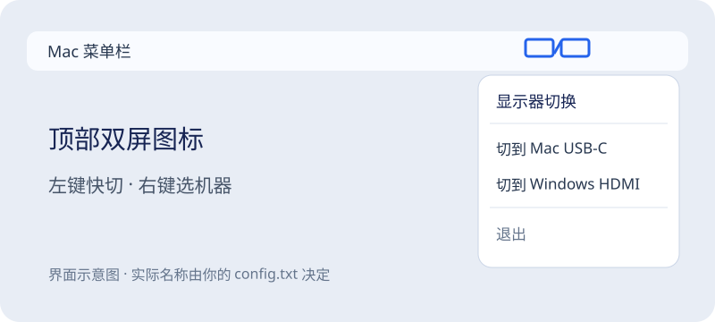
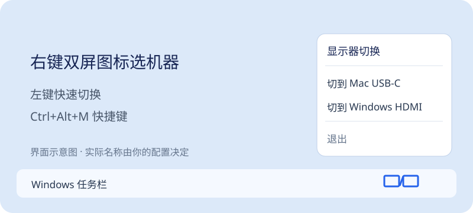

# 显示器切换：下载、安装、使用

这个软件让同一台支持 DDC/CI 的显示器在多台电脑（Mac / Windows）之间切换输入源。每台电脑各装自己的版本。电脑和显示器仍需要各自的线缆；软件不会替代视频线。

## 1. 下载

打开 [GitHub 最新发布页](https://github.com/Mr-c1203/display-switch/releases/latest)，在 **Assets** 中下载：

| 你的电脑 | 下载文件 |
| --- | --- |
| Mac | `DisplaySwitch-macOS-<版本>.zip` |
| Windows | `DisplaySwitch-Windows-<版本>.zip` |

下载后解压，不要从压缩包内部直接运行。

## 2. 显示器准备

- 在显示器自身的屏幕菜单（OSD）里打开 **DDC/CI**。
- 想让键盘鼠标跟着切：接在显示器上的键鼠只会跟随「有 USB 上行线」的电脑。USB-C 视频线自带 USB；HDMI/DP 接的电脑要另外拉一根 USB 线到显示器的 USB 上行口。
- 经过扩展坞或转接头时，DDC/CI 可能被阻断，软件就切不动。

## 3. Mac 安装

1. 把 `显示器切换.app` 拖到「应用程序」，打开。
2. 菜单栏出现双显示器图标。第一次会问「要自动识别接口吗」，点「现在识别」。屏幕会闪几次，1–3 分钟后切回本机，并列出识别到的接口（USB-C、HDMI、DP 等；没接电脑的口也能识别）。

下载包为临时签名。若 macOS 提示无法打开，请先核实下载来源，再在「系统设置 → 隐私与安全性」里按系统允许的方式打开；不要关闭系统安全保护。

## 4. Windows 安装

1. 解压 Windows 包，双击 `install.bat`。
2. 程序装到 `%LocalAppData%\显示器切换\app`，设为开机自启并启动。右下角托盘出现双显示器图标，第一次同样会提示识别接口。

## 5. 日常使用

- **点图标**：弹出菜单，列出所有接口，打勾的是当前显示的口。选哪个就切到哪个。点图标本身不会直接切换。
- **快捷键**：菜单 →「快捷键」设置循环切换（默认 Mac ⌃⌥\`、Windows Ctrl+Alt+\`），在已用过的电脑之间轮换；「管理这台显示器 → 设置接口快捷键」可给某个接口设直达快捷键。
- **填电脑名字**：「管理这台显示器 → 给接口填电脑名字」，菜单会显示成「HDMI 1 — Mac mini」。
- **新接了一台电脑**：直接在菜单里选它所在的接口即可；换了显示器会自动提示识别。

切换后软件会盯约半分钟，显示器若因画面重新握手自己跳回别的口，会自动切回去。如果目标口真的没有画面信号（电脑没开、睡眠、线没插），会提示原因。

## 6. 升级

菜单 →「关于显示器切换 / 检查更新」。有新版本时点「升级」，自动下载、替换并重启。每台电脑各自点一次。有新版本时菜单顶部也会出现「升级到新版本」。

## 常见问题

- **选了接口但画面没变 / 提示跳回**：那个口没有画面信号。确认电脑接在这个口上、已开机、没有睡眠黑屏；笔记本合盖使用要接电源。
- **识别漏了某个口**：用显示器按钮切到那个口，再在菜单「学习当前输入」；或「手动添加编号」。
- **显示器没有回应**：检查 OSD 里的 DDC/CI；换直连线排除扩展坞。
- **远程连接时**：切走后本机画面就不在显示器上了，远程操作时谨慎切换。
