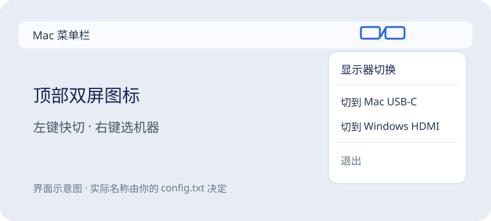
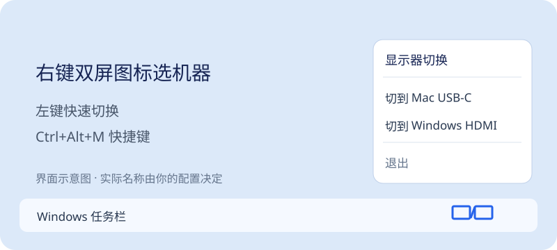

# 显示器切换：下载、安装、使用

这个软件让同一台支持 DDC/CI 的显示器在 Mac 与 Windows 之间切换输入源。两台电脑各安装自己的版本。电脑和显示器仍需要各自的线缆；软件不会替代视频线。

## 1. 下载

打开 [GitHub 最新发布页](https://github.com/Mr-c1203/display-switch/releases/latest)，在 **Assets** 中下载：

| 你的电脑 | 下载文件 | 用途 |
| --- | --- | --- |
| Mac | `-macOS-1.1.0.zip` | 菜单栏应用 |
| Windows | `-Windows-1.1.0.zip` | 托盘应用及安装脚本 |

GitHub 显示的压缩包名字可能省略中文前缀，以 **macOS** 或 **Windows** 结尾区分即可。下载后解压，不要从压缩包内部直接运行。

## 2. 先确认显示器输入源

在显示器自身的屏幕菜单（OSD）里打开 **DDC/CI**。确认 Mac 和 Windows 分别插在哪个接口，并查出这台显示器的 VCP `0x60` 输入源编号。**编号因显示器和接口而异；不要照搬教程里的示例 `21` 或 `17`。**

如果显示器通过扩展坞连接，扩展坞可能不透传 DDC/CI。软件可以正常打开，但切换指令可能不起作用。

## 3. Mac 安装和使用

1. 将 `显示器切换.app` 放到“应用程序”。
2. 首次使用前，打开应用包内的 `Contents/Resources/config.txt`，按 `编号,名称` 一行一个填写两台电脑。示例只是格式：

   ```text
   21,Mac USB-C
   17,Windows HDMI
   ```

3. 修改包内配置后，在终端重新签名：`codesign --force --deep --sign - /Applications/显示器切换.app`。
4. 打开应用。顶部菜单栏出现双显示器图标，**左键**快速切换到另一台电脑，**右键**打开菜单并选择目标输入源。



升级旧 `MonitorSwitch.app` 的用户可使用仓库的 `install-mac.py` 保留旧配置并自动备份。升级时请先确认目标应用的实际路径，不要让两个副本同时开机启动。由于下载包采用临时签名，macOS 若提示无法打开，请先核实下载来源与发布页，再按系统允许的正常应用打开流程处理；不要关闭系统安全保护。

## 4. Windows 安装和使用

1. 将 Windows 压缩包解压到固定目录，保留其中的 `.exe`、`.ico`、`.ps1` 文件在同一文件夹。
2. 打开该目录的 PowerShell，传入你已核实的两个输入源编号，例如：

   ```powershell
   .\install.ps1 -TargetCode 21 -ThisCode 17
   ```

   如果 PowerShell 阻止脚本运行，可以使用包内 `install.bat`，它会在当前安装进程内运行脚本。
3. 安装完成后，右下角托盘出现双显示器图标。**左键**切换到另一台电脑，**右键**打开输入源菜单；桌面快捷方式可用 **Ctrl+Alt+M** 切换。



安装脚本会备份同目录的旧版程序与配置，并创建开机启动项。实际切换前请先确认屏幕不会影响正在进行的远程会话。

## 常见问题

- **图标出现但屏幕没切换**：核对显示器 DDC/CI、实际线缆接口和 VCP 输入源编号；试用直连线缆排除扩展坞阻断。
- **菜单只有一台电脑**：检查配置里是否写了两个不同的输入源编号。Windows 配置在 `TraySwitcher.ini`，Mac 配置在应用包内 `Contents/Resources/config.txt`。
- **远程连接后黑屏或失联**：在本地用显示器物理按键切回原输入源，再检查配置。远程操作时不要用未核验的编号试切换。
- **升级后想恢复**：Mac 安装脚本在项目 `backups/` 保存旧应用；Windows 安装脚本在原安装目录留下带时间的 `.backup-*` 文件。

发布包不含任何人的专用显示器配置。软件只向本机显示器发送切换指令，不需要账号登录。
